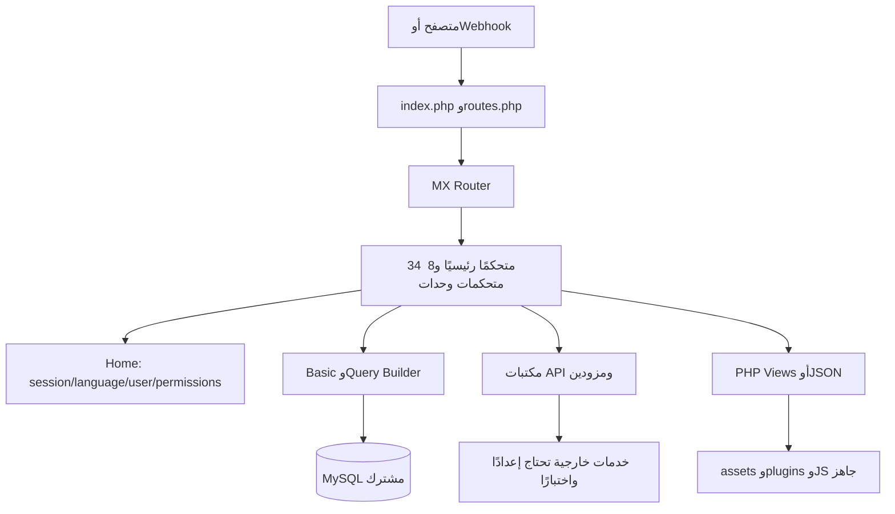

# 01 — معمارية المشروع ونطاق التدقيق

تاريخ اللقطة: **29 أكتوبر 2026**. الهدف: تقييم النسخة المحلية لتخطيط Wasla AI (وصلة)، بالاعتماد على Source Code. لا توجد ميزة مصنفة «تعمل فعليًا» في هذا التدقيق. تم السماح بكتابة هذه التقارير فقط؛ لم يُشغل التطبيق أو المثبت أو Cron أو Composer أو migrations، ولم يتم الاتصال بقاعدة أو بخدمات المنتج الخارجية. اقتصر التصفح الخارجي على صفحات توثيق عامة للمورد.

## النطاق والمنهج

جُرد **11,110 ملفات** قبل إنشاء هذا المجلد، باستثناء `.git/`. قُرئ نصيًا **8,801 ملف** من امتدادات الشيفرة والإعداد والتوثيق وSQL وsource maps؛ جرى استبعاد **501 ملفًا** مطابقة لقواعد أسماء الترخيص والاتصال والجلسات وcache/logs. جُردت **1,808 ملفات أخرى** على مستوى المسار والنوع، ومنها صور وخطوط ووسائط. مجموع الفئات = 11,110. لا يعني الجرد البصري أو النصي أن كل ملف مكتبة خارجية خضع لمراجعة سطرية يدوية.

لم تظهر إخفاقات قراءة ضمن نطاق النصوص المختارة. لا يوجد مجلد مشروع تعذر تعداد محتوياته. `.git/` خارج نطاق المنتج، والملفات الحساسة والسجلات والتراخيص مستبعدة عمدًا من عرض المحتوى. جرى استخراج DDL من SQL دون نسخ INSERT أو صفوف أو بيانات حسابات. تعد هذه القيود جزءًا من حدود النتيجة، وليست دليلًا على اكتمال تدقيق أمني لكل سطر.

العمل جمع بين جرد شامل، وبحث عن الأسماء الحديثة والقديمة، واستخراج classes/methods والاعتمادات الثابتة، وتتبع يدوي لمسارات الوظائف، ومراجعة DDL والقوالب والحزم الجاهزة، ثم تصنيف مستقل للشيفرة والإعداد والتحقق والتسويق. عدم العثور يعني عدم العثور في هذا النطاق، وليس استحالة وجود ميزة في إصدار آخر أو إضافة غير موجودة.

## النسخة والبيئة

| البند | النتيجة والدليل |
| --- | --- |
| إصدار التطبيق | `9.1.1` في [my_config.php](../../application/config/my_config.php)، وليس build مثبتًا من قاعدة تشغيل |
| Build/Release | لا يوجد manifest مستقل يثبت build ID أو تاريخ إصدار هذه النسخة؛ لا يستنتج من اسم المجلد |
| Framework | CodeIgniter `3.1.5` في [CodeIgniter.php](../../system/core/CodeIgniter.php) |
| HMVC | [MY_Router.php](../../application/core/MY_Router.php)، [MY_Loader.php](../../application/core/MY_Loader.php)، و`application/third_party/MX/` |
| PHP المعلن | `>=7.4.0` في [composer.json](../../composer.json) |
| PHP الذي تفرضه الاعتمادات | `>=8.1.0` في [platform_check.php](../../vendor/composer/platform_check.php)؛ لا يثبت توافق التطبيق بأكمله مع PHP حديث |
| Database | MySQL عبر MySQLi؛ SQL يحمل metadata تصدير MySQL 5.7.24، وليس شرط حد أدنى مثبتًا |
| الحد الأدنى لـMySQL | **UNDETERMINED** من الشيفرة؛ لا يوجد اختبار توافق أومصفوفة دعم محلية تؤكد حدًا دقيقًا |
| المخطط الأولي | 118 جدولًا و1904 حقول، دون `FOREIGN KEY` في DDL؛ مزيج utf8 وutf8mb4 |
| اتصال القاعدة | `application/config/database.php` غير موجود، ولم يُنشأ |
| Installation marker | `application/install.txt` غير موجود؛ لا يدل ذلك وحده على تثبيت صالح |
| Runtime tools | لم يتوفر PHP أوComposer كأوامر في PATH أثناء الفحص؛ لم يجر تثبيتهما |

صفحة المورد التي فُتحت تعرض إصدارًا `9.3.4`، وهو مختلف عن المحلي. لا يجوز إسقاط ميزاته على هذه النسخة. [مرجع المورد](https://xeroneit.net/portfolio/chatpion-best-multichannel-marketing-application-white-label).

## مسار الطلب والبيانات

[index.php](../../index.php) يستخدم `system/` وليس `ci/` كإطار تشغيل، ووضعه الافتراضي `development` عند غياب `CI_ENV`. [routes.php](../../application/config/routes.php) يوجه البداية إلى `home` و404 إلى `home/error_404`. بقية المسارات تعتمد class/method ومعالجة MX للوحدات، وليست REST API موثقة تلقائيًا.

[autoload.php](../../application/config/autoload.php) يحمل session/form_validation/pagination وurl/form وmy_config/package_config/frontend_config. يتولى [Home](../../application/controllers/Home.php) تحميل القاعدة وBasic خارج مساري التثبيت، وسياق الحساب واللغة والوقت. أغلب المتحكمات ترثه؛ `Paypal_ipn` يرث CI_Controller مباشرة. التشابك مرتفع: Home يجمع الهوية والقوالب والإضافات والبريد والحدود والحذف وWebhook ومنطق مشتركين ومحادثات.

[Basic.php](../../application/models/Basic.php) يوفر CRUD عامًا وSQL مباشرًا و`import_dump()`؛ لا يوجد نموذج domain مستقل لكل كيان. توجد استعلامات مباشرة بالمتحكمات أيضًا. ينفذ منشئ Home إفراغ `sql_mode` للجلسة و`SET NAMES utf8mb4`؛ يلزم اختبار التوافق بدل افتراض سلوك strict SQL.

## جرد المجالات والمجلدات

| المسار | الوظيفة والتحقق |
| --- | --- |
| `application/controllers/` | 34 ملفًا: البوت، التعليقات، النشر، العملاء، المتجر، الفوترة، الإعداد والإدارة |
| `application/modules/` | 8 وحدات موضحة أدناه؛ وجودها لا يثبت تسجيلها بقاعدة حية |
| `application/views/` | قوالب الإدارة، livechat، messenger_tools، ecommerce، SMS/Email، الموقع العام |
| `application/models/` | Basic وGrocery_CRUD_Model |
| `application/helpers/` | my_helper وbot_helper وecommerce_helper وaddon_helper |
| `application/libraries/` | مكتبات مخصصة وSDKs Facebook/Google/Twilio/Stripe/Mandrill/MercadoPago وغيرها |
| `application/config/` | PHP config files؛ بعض شاشات الإدارة تعيد كتابتها |
| `application/language/` | 13 مجلد لغة، منها arabic وenglish؛ للوحدات ترجمات إضافية |
| `system/`, `application/third_party/MX/` | Framework وامتداد تحميل الوحدات |
| `ci/` | ملفات مرجعية وترخيص إطار، ليس تطبيقًا ثانيًا مفعلًا |
| `assets/`, `plugins/`, `js/` | واجهات ومحررات ومكتبات ورسوم؛ `plugins/flow_builder` حزم جاهزة وsource maps |
| `assets/backup_db/` | SQL أولي محمي نظريًا بـ.htaccess؛ يلزم اختبار الحماية على الخادم |
| `documentation/` | دليل HTML محلي مصور للميزات؛ ليس إثباتًا لوجود الإضافات |
| `upload/`, `upload_caster/`, `download/`, `member/` | ملفات ووسائط وتصدير ومسارات تشغيل؛ لم تُستخدم أثناء التدقيق |
| `vendor/` | حزم Composer الموجودة؛ إدراجها لا يثبت تنفيذ install ناجحًا في هذه البيئة |

الوحدات: `ai_reply 1.1`, `blog 1.0`, `instagram_bot 1.0`, `instagram_poster 1.0`, `menu_manager 1.0`, `simplesupport 1.0`, `ultrapost 1.0`, `visual_flow_builder 1.6.9`. الإصدارات من metadata المصدر. لا يوجد `install.txt` داخل أي منها؛ ذلك **لا يثبت active/installed**، ولا يمكن تحديد present-but-disabled دون بيانات التسجيل والصلاحيات التي لم تُقرأ. تفاصيل كل إضافة في [03](03-addons-inventory.md).

## الهوية والصلاحيات والاشتراكات

`Home::login()/sign_up_action()/recovery_check()` والجلسة هي البنية الأساسية. توجد Admin/Member، و`module_access` من package.module_ids، و`team_access` و`is_manager/real_user_id` في مسارات الفريق. [my_helper.php](../../application/helpers/my_helper.php)::`check_module_access()/check_module_action_access()` يكمل فحوص المتحكمات. قوائم التنقل ليست حدًا أمنيًا بحد ذاتها.

`Payment` و`Stripe_action` و`Paypal_ipn` يعالجون باقات وعمليات دفع ومدة حساب؛ `Home::_check_usage()` وusage_log يديران الحصص. قاعدة مشتركة بـuser_id وليست tenancy databases. القيود القانونية والتشغيلية منفصلة؛ [06](06-saas-white-label-audit.md).

## الخلفية والتكامل

المهام في [Cron_job.php](../../application/controllers/Cron_job.php)، وأوامرها في [command.php](../../application/views/admin/cron_job/command.php). بث كل دقيقة، نشر وتعليقات كل 5 دقائق، وصيانة عضوية يومية؛ بعض التسلسلات مرتبطة بإضافات. توجد استدعاءات cURL داخلية بمهلات قصيرة، وحالات معالجة في الجداول؛ لم يوجد Queue worker مستقل مع broker أوDocker/CI deployment pipeline خاص بالتطبيق. يجب اختبار التعافي ومنع التكرار.

`Home::central_webhook_callback()` يوزع إلى Messenger_bot وComment_automation وInstagram_reply. مكتبات المزودين تحفظ إعداداتها في جداول أوPHP config. Pusher اختياري؛ قيمه الأساسية فارغة في ملف الإعداد الحالي، دون نشرها هنا. [04](04-integrations-and-apis.md) و[07](07-security-and-readiness.md).

## العربية والهوية والتثبيت

`Home::_language_loader()` و`Multi_language` و`is_rtl` والقوالب تدعم الترجمة واتجاه الواجهة. `Admin::general_settings_action()` يغير الاسم والشعار والأيقونة، وMyprofile يحفظ brand_logo للمستخدم، وThemes/Custom_theme_manager يديران قوالب. توجد مراجع ثابتة للمورد؛ White Label كامل يحتاج جردًا واختبارًا ولا يستنتج من إمكانية تغيير logo.

المثبت في `Home::installation_action()` يكتب إعداد اتصال، ويستورد SQL، ويحدث مديرًا ويسجل الإصدار ويحذف marker. **لم يُنفذ**. يحتاج cURL وmbstring وMySQLi وملفات قابلة للكتابة، مع امتدادات صور/ZIP/Fileinfo حسب الميزات. SQL الأولي لا يغطي كل الجداول المشار إليها في الإضافات. لا توصية باستيراده على قاعدة قائمة.

## دليل قراءة التقارير

- [02: الميزات الأساسية](02-core-features.md)، [03: الإضافات](03-addons-inventory.md)، [04: التكاملات](04-integrations-and-apis.md).
- [05: AI وWhatsApp](05-ai-and-whatsapp-audit.md)، [06: SaaS والهوية](06-saas-white-label-audit.md)، [07: الأمن والجاهزية](07-security-and-readiness.md).
- [08: المصفوفة المرجعية](08-master-feature-matrix.md)، [09: تسويق وصلة](09-wasla-marketing-features.md)، [10: الفجوات](10-development-gap-analysis.md)، [11: الملخص التنفيذي والأعداد](11-executive-summary.md).

الـREADME الموجود مسبقًا لم يُعدل في هذا التدقيق. التقارير الحالية أدق في تقييم تشغيل WhatsApp والإضافات؛ وجود إعدادات قديمة أوأيقونات لا يساوي منتجًا مكتملًا.
+
## فهرس المتحكمات الرئيسية الكامل

الأعداد التالية تعريفات دوال مسماة مكتشفة نصيًا، وليست عدد endpoints المتاحة أوعدد ميزات المنتج؛ الوصول يتأثر بالوراثة والبادئة والصلاحيات. متحكمات الوحدات الثمانية مستقلة في جرد03.

| المصدر | الوراثة | تعريفات الدوال | النطاق |
| --- | --- | ---: | --- |
| [Addons.php](../../application/controllers/Addons.php) | Home | 7 | تحميل وفهرسة الإضافات |
| [Admin.php](../../application/controllers/Admin.php) | Home | 26 | إعدادات الإدارة والمستخدمين والهوية |
| [Announcement.php](../../application/controllers/Announcement.php) | Home | 11 | إعلانات وإشعارات المستخدمين |
| [Autoposting.php](../../application/controllers/Autoposting.php) | Home | 14 | مصادر feeds وحملاتها |
| [Calendar.php](../../application/controllers/Calendar.php) | Home | 4 | تقويم وجدولة حملات |
| [Change_password.php](../../application/controllers/Change_password.php) | Home | 4 | تغيير كلمة مرور الحساب |
| [Comment_automation.php](../../application/controllers/Comment_automation.php) | Home | 75 | أتمتة تعليقات Facebook |
| [Cron_job.php](../../application/controllers/Cron_job.php) | Home | 37 | تنفيذ المهام الخلفية |
| [Custom_theme_manager.php](../../application/controllers/Custom_theme_manager.php) | Home | 6 | إدارة تخصيص القوالب |
| [Dashboard.php](../../application/controllers/Dashboard.php) | Home | 8 | لوحة البيانات والإيرادات |
| [Demo_account_delete.php](../../application/controllers/Demo_account_delete.php) | Home | 6 | حذف حسابات وبيانات العرض |
| [Ecommerce.php](../../application/controllers/Ecommerce.php) | Home | 176 | المتجر والطلبات والدفع |
| [Email_auto_responder_integration.php](../../application/controllers/Email_auto_responder_integration.php) | Home | 34 | ربط قوائم وخدمات البريد |
| [Home.php](../../application/controllers/Home.php) | CI_Controller | 150 | الهوية والسياق والخدمات المشتركة |
| [Instagram_reply.php](../../application/controllers/Instagram_reply.php) | Home | 43 | تعليقات Instagram ومقاييسها |
| [Integration.php](../../application/controllers/Integration.php) | Home | 9 | قنوات التكامل وإعداد AI |
| [Livechat.php](../../application/controllers/Livechat.php) | Home | 25 | محادثات FB/IG وملفاتها |
| [Messenger_bot.php](../../application/controllers/Messenger_bot.php) | Home | 134 | الردود وWebhook والقوالب |
| [Messenger_bot_analytics.php](../../application/controllers/Messenger_bot_analytics.php) | Home | 2 | تحليلات Messenger |
| [Messenger_bot_broadcast.php](../../application/controllers/Messenger_bot_broadcast.php) | Home | 30 | حملات OTN/RCN وتقاريرها |
| [Multi_language.php](../../application/controllers/Multi_language.php) | Home | 14 | إدارة ملفات الترجمة |
| [Myprofile.php](../../application/controllers/Myprofile.php) | Home | 5 | ملف المستخدم وعلامته |
| [Native_api.php](../../application/controllers/Native_api.php) | Home | 4 | توليد مفتاح API |
| [Page_analytics.php](../../application/controllers/Page_analytics.php) | Home | 3 | تحليلات Facebook Page |
| [Payment.php](../../application/controllers/Payment.php) | Home | 31 | باقات وفوترة وتسجيل معاملات |
| [Paypal_ipn.php](../../application/controllers/Paypal_ipn.php) | CI_Controller | 5 | استقبال والتحقق من إشعارات PayPal |
| [Sms_email_manager.php](../../application/controllers/Sms_email_manager.php) | Home | 121 | جهات اتصال ومزودون وحملات وقوالب |
| [Social_accounts.php](../../application/controllers/Social_accounts.php) | Home | 30 | استيراد وربط الحسابات الاجتماعية |
| [Social_apps.php](../../application/controllers/Social_apps.php) | Home | 20 | إعداد تطبيقات OAuth |
| [Stripe_action.php](../../application/controllers/Stripe_action.php) | Home | 22 | معالجة نتائج بوابات دفع متعددة |
| [Subscriber_manager.php](../../application/controllers/Subscriber_manager.php) | Home | 32 | الجمهور والوسوم والحقول |
| [Themes.php](../../application/controllers/Themes.php) | Home | 9 | إدارة القوالب |
| [Update_system.php](../../application/controllers/Update_system.php) | Home | 6 | فحص وتهيئة تحديثات المورد |
| [Webview_builder.php](../../application/controllers/Webview_builder.php) | Home | 11 | مدخلات ويب للتاريخ والموقع والبريد والهاتف |
